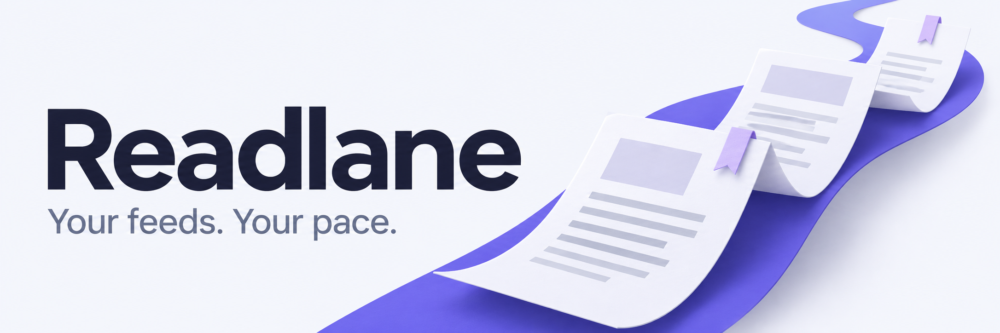
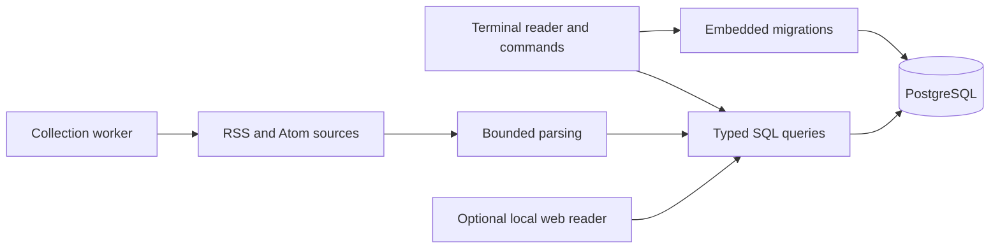

# Readlane — a terminal-first feed reader

Collect the publications you follow and make time for the stories that matter to you, straight from your terminal.

Readlane brings RSS and Atom feeds into a PostgreSQL-backed reading list. Browse with the keyboard, search collected posts, or use small commands in your own workflow. A quiet web reader is included for the moments you want more room on the page.

[Start reading](#-installation) · [Terminal guide](docs/terminal.md) · [Operations](docs/operations.md)

##  Features

- **A proper terminal reader.** Move through stories, search, filter by source, and open a scrollable summary without leaving the terminal. Light/dark colors follow the terminal; `NO_COLOR` is respected.
- **Commands that compose.** Manage sources, follow feeds, inspect collection, and print posts without entering the interactive view. Redirected output stays free of color escapes.
- **Collection that keeps its place.** A single worker per database, timeouts, bounded responses, persistent retry backoff, and HTTP cache validators keep repeated runs predictable.
- **Your sources, kept locally.** PostgreSQL stores posts and subscriptions; URL uniqueness prevents duplicate articles. Embedded migrations travel with the binary.
- **An optional web companion.** Read the same collected stories in a local, read-only interface with search and source filters. The terminal remains the place for setup, management, and collection.

Readlane is for a **trusted local environment**. Reader selection is not authentication: anyone with its database credentials can access the data. There is no hosted account system or public web service.

##  Installation

You need **Go 1.27.2+**, PostgreSQL 15+, and a terminal. The optional local database helper also needs Python 3 and the PostgreSQL server tools (`initdb`, `pg_ctl`, `psql`, and `createdb`) in `PATH`.

From this checkout:

```sh
go install ./cmd/readlane
```

Add `$(go env GOBIN)` to `PATH`, or `$(go env GOPATH)/bin` when `GOBIN` is unset. Alternatively, install a version-stamped build in `~/.local/bin`:

```sh
make install
```

The installed executable includes the terminal reader, web assets, and migrations. **Go, Node.js, sqlc, and Goose are not needed at runtime.** A trusted CA certificate store is needed for HTTPS feeds. Linux and macOS are the supported local environments; the supplied service unit is for Linux/systemd.

### Connect your database

For an existing server, create a dedicated database and role, copy `config.example.json` to `~/.readlane.json`, and edit `db_url`.

To start a private local PostgreSQL cluster instead:

```sh
./scripts/start-local-postgres.sh
```

The helper prints configuration JSON. Copy **only that JSON** into `~/.readlane.json`. It creates a database over an OS-user-authenticated Unix socket and opens no TCP listener. It never overwrites your config. Existing course-era data is reused when detected; see [migration](docs/migration.md).

```sh
chmod 600 ~/.readlane.json
readlane migrate
readlane doctor
```

`doctor` should report `Database reachable; schema up to date`. Use certificate-verified TLS (`sslmode=verify-full`) for a remote PostgreSQL server. Local sockets and isolated test databases may use `sslmode=disable`.

##  Quick start

```sh
readlane register alice
readlane addfeed "Lane's Blog" https://www.wagslane.dev/index.xml
readlane collect 1m --once
readlane
```

In a terminal, `readlane` opens the interactive reader. Select a story with **↑/↓**, open its summary with **Enter**, and return with **Esc**. Press **/** to search, **Tab** for sources, and **q** to quit.

For continuous collection, run this in another terminal:

```sh
readlane collect 1m
```

Stop the collector with **Ctrl+C**. The interactive reader does not start a collector automatically. Press **r** to refresh after new posts arrive. `--once` attempts one **due** feed and exits; an existing feed may still be waiting for its next scheduled visit.

Prefer plain output?

```sh
readlane read 5
```

##  Usage

### Read in the terminal

| Key | Action |
| --- | --- |
| ↑/↓ or j/k | Move through stories or sources |
| Enter | Open the selected summary or apply a source filter |
| Esc | Return from a summary or finish editing a search |
| / | Search collected titles and feed content |
| Ctrl+U | Clear the search |
| Tab | Switch between reading list and sources |
| n/p, →/←, Page Down/Page Up | Move between list pages |
| ↑/↓, Page Down/Page Up in a summary | Scroll the summary |
| a | Return to all followed sources |
| r | Refresh the current list |
| q or Ctrl+C | Close the reader |

The reader adapts down to 40 columns and 14 rows. Smaller terminals receive guidance to enlarge the window or use plain output. Search typing takes priority over shortcuts, so typing `q` in the search field does not quit. Stories are shown in pages of 20; the source chooser shows up to 200 sources, while `readlane sources` lists the complete registry.

### Manage and collect

```sh
readlane sources
readlane following
readlane follow https://www.wagslane.dev/index.xml
readlane preview https://www.wagslane.dev/index.xml
readlane users
readlane login alice
```

See the [terminal command reference](docs/terminal.md) for arguments, errors, pagination, and administrative commands. The earlier command names `agg`, `browse`, `feeds`, and `fetch` remain aliases.

### Open the web companion

```sh
readlane serve
```

Open **http://127.0.0.1:8090**. Search posts, choose a source, and read stored feed summaries. The original article opens separately. The companion does not collect posts or change your data; keep using the terminal for those operations.

Use `--user alice` to choose a reader for that server process, or `--addr 127.0.0.1:8091` for another local port. Public bind addresses are rejected. Stop the server with **Ctrl+C**. See [web reader details](docs/web-reader.md).

##  Configuration

| Setting | Purpose |
| --- | --- |
| `~/.readlane.json` | Private JSON containing `db_url` and `current_user_name` |
| `READLANE_CONFIG` | Select a different config file |
| `READLANE_DATABASE_URL` | Override the connection in memory; never persisted by reader switching |
| `READLANE_LOG_FORMAT=json` | Structured collector logs on stderr |
| `NO_COLOR` | Disable terminal color |
| `READLANE_TEST_DATABASE_URL` | Enable integration checks against a database whose name ends in `_test` |
| `READLANE_POSTGRES_ROOT` / `READLANE_POSTGRES_PORT` | Customize the local database helper |

Config updates write and sync a private temporary file before renaming it into place. Separate `READLANE_CONFIG` files allow independent reader selections. Existing `.gatorconfig.json` and the legacy config/database/logging environment variables are accepted during migration; the new names take precedence.

##  Architecture

The terminal is the main application. Its interactive and command modes use the same parameterized SQL queries, parsing, and database model as the collector and optional web companion.



The worker holds a dedicated database connection and advisory lock. Each feed attempt is recorded before the request so one broken source cannot starve the others. Successful feeds have at least a one-minute cooldown; failures back off from 1 to 256 minutes. `Retry-After` can extend this to 24 hours.

The executable embeds the web interface, local fonts with their licenses, and SQL migrations. Its [design system](DESIGN.md) generates shared terminal and web palette tokens. Source lives in [`internal/app`](internal/app), queries in [`sql/queries`](sql/queries), and the companion assets in [`internal/web`](internal/web).

##  Verification

```sh
go install github.com/sqlc-dev/sqlc/cmd/sqlc@v1.31.1
go install golang.org/x/vuln/cmd/govulncheck@v1.9.0
make verify
```

Without `READLANE_TEST_DATABASE_URL`, database tests explicitly skip. Set it to a disposable database ending in `_test` for the full race-enabled integration suite. `make smoke` additionally exercises the built executable, backup/restore, and restricted worker grants; it needs PostgreSQL client tools, Python 3, and a test role allowed to create databases and roles.

Development-only companion checks require Node.js 26+:

```sh
npm ci --ignore-scripts
make web-check
```

[Verification notes](docs/verification.md) distinguish local tests, actual terminal checks, companion DOM/API checks, and unverified browser rendering. GitHub CI is configured but has not run remotely because this checkout has no published remote.

##  Security and limitations

Readlane runs on a trusted machine. Its reader names are not accounts or authorization boundaries. Add only sources you trust: the collector can reach local network URLs and is not an SSRF sandbox. The companion accepts only loopback listeners and read-only requests, checks Host and Origin, and emits a restrictive content security policy. It must not be exposed through a public proxy or tunnel.

Requests have a 30-second timeout and an 8 MiB decoded-body limit. HTTPS-to-HTTP redirects are rejected. Feed text is stripped of terminal controls, and web summaries render as text rather than executable HTML. Publication dates that cannot be parsed stay unknown.

Posts are deduplicated globally by URL and are not updated when an original article changes. A URL first stored by one source remains attached to that source. Pagination may shift as posts arrive. Summaries are feed content, not guaranteed full articles. Retention is manual, so storage grows over time.

The [operations guide](docs/operations.md) covers the hardened collector service, database roles, backups, recovery, and upgrades. The [migration guide](docs/migration.md) preserves existing data when moving from the course name. Font license notices are retained with the bundled assets; the generated cover's metadata contains only the owner's creator and copyright credits.

> Built from Boot.dev's **Build a Blog Aggregator in Go** guided project. Readlane extends that foundation with a terminal-first reading experience, local web companion, persistent retries, embedded migrations, and release verification.
