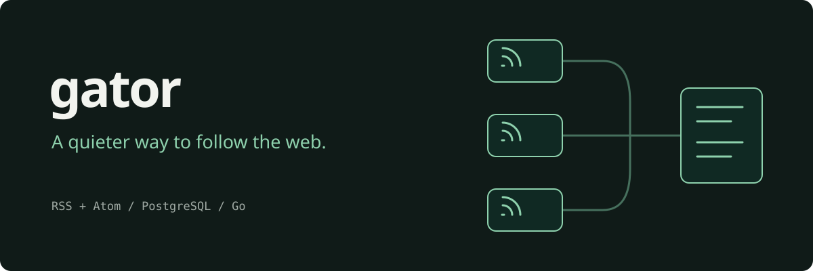
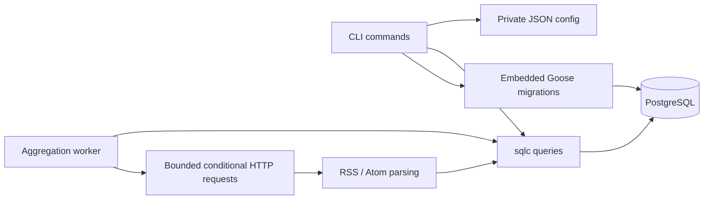

# Gator — RSS and Atom feed aggregator

Follow blogs and news feeds, collect their posts in PostgreSQL, and read summaries from your terminal.

Gator is a local CLI with a separate, long-running collection worker. Feeds are shared between local users; each user's subscriptions determine what appears in `browse`. It is designed for a trusted machine or a single operator. **Selecting a user is not authentication:** anyone with the database credentials can access or change its data.

[Run Gator](#-installation) · [Operate the worker](docs/operations.md)

##  Features

- Collect RSS and Atom feeds, resolve relative article links, and keep one post per URL.
- Follow shared feeds and browse only your subscriptions, with limits and offsets.
- Keep collection predictable: one worker per database, request timeouts, response limits, and a minimum interval.
- Persist retry backoff and HTTP cache validators so restarts preserve scheduling and unchanged feeds avoid repeat downloads.
- Apply embedded migrations from the installed executable and inspect database readiness with `doctor`.

##  Installation

Build requirements: **Go 1.27.2+**, Git, and PostgreSQL 15+. The compiled `gator` executable needs PostgreSQL and a trusted CA certificate store; it does not need Go, sqlc, or Goose installed. Linux and macOS are the supported local operating environments. The service unit requires Linux with systemd and user namespace support.

From this checkout:

```sh
go install ./cmd/gator
```

This installs `gator` in `$(go env GOBIN)`, or `$(go env GOPATH)/bin` if `GOBIN` is unset. Add that directory to `PATH`. To build and install a version-stamped binary in `~/.local/bin` instead:

```sh
make install
```

### Set up PostgreSQL and private configuration

Use an existing PostgreSQL database and a dedicated role, or start a local cluster owned by your OS user:

```sh
./scripts/start-local-postgres.sh
```

The helper requires PostgreSQL server tools and Python 3. It creates `gator` if needed, stores the cluster under `~/.local/share/blog-aggregator`, accepts Unix-socket connections using OS-user identity, and opens no TCP listener. It prints configuration JSON; copy **only that JSON** into `~/.gatorconfig.json`. Existing configuration is never overwritten by the helper.

For an existing server, use `config.example.json` as a template and set `db_url` to your connection URL. Use `sslmode=verify-full` for remote connections and configure a trusted certificate authority; `sslmode=disable` is intended for local sockets or isolated test environments.

```sh
chmod 600 ~/.gatorconfig.json
gator migrate
gator doctor
```

Successful output includes `Database migrations applied` and `Database reachable; schema up to date`. The executable embeds every migration; a source checkout is not needed to migrate an installed version. Back up existing databases before upgrading.

##  Quick start

```sh
gator register alice
gator addfeed "Lane's Blog" https://www.wagslane.dev/index.xml
gator agg 1m --once
gator browse 2
```

`addfeed` also follows the new feed. `agg --once` attempts **one due feed** and exits; on a new database, that is the feed just added. `browse` prints article titles, publication dates, links, and plain-text summaries. Missing or unparseable dates remain unknown.

For continuous collection, run `gator agg 1m` in another terminal. Stop it with **Ctrl+C**; SIGTERM also cancels in-flight requests and releases the worker lock. A supervised Linux service is documented in [operations](docs/operations.md).

##  Usage

| Command | Behavior |
| --- | --- |
| `gator help` / `gator version` | Show commands or the build version; no config or database required |
| `gator migrate` | Apply pending embedded migrations with a PostgreSQL migration lock |
| `gator doctor` | Check database connectivity and pending migrations |
| `gator register <name>` | Create and select a user; duplicate names fail |
| `gator login <name>` | Select an existing user |
| `gator users` | List users and mark the current one |
| `gator addfeed <name> <url>` | Create a unique feed and its first follow in one transaction |
| `gator feeds` | List feed names, URLs, creators, and failure retry schedules |
| `gator follow <url>` / `gator unfollow <url>` | Change the current user's subscription |
| `gator following` | List the current user's subscriptions |
| `gator fetch <url>` | Preview RSS or Atom without a config or database |
| `gator agg <interval> [--once]` | Collect one due feed per cycle; minimum interval is `5s` |
| `gator browse [limit] [offset]` | Read posts, newest known publication dates first; limit defaults to 2 and accepts 1–100 |
| `gator reset --confirm` | **Delete all users, feeds, follows, and posts**, then clear the current user |

Use quoted names with spaces. URLs must use HTTP or HTTPS and cannot contain embedded user credentials. Article URLs are deduplicated globally. Posts with invalid article URLs are skipped.

The worker waits for the requested interval **after** each attempt. Successful feeds receive a one-minute minimum cooldown. Failed feeds retry after 1, 2, 4, … minutes, up to 256 minutes. HTTP `Retry-After` can extend that delay, capped at 24 hours. Attempts are recorded before the request, so a failed feed does not starve others. If nothing is due, the worker waits rather than making a request.

### Troubleshooting

- `config must be private` → run `chmod 600` on the file selected by `GATOR_CONFIG` or the default file.
- `database unavailable` → check the PostgreSQL process, database URL, role, and socket or network access. Gator intentionally excludes connection credentials from this error.
- `schema is out of date` → run `gator migrate` with an account allowed to alter the schema.
- `an aggregation worker is already running` → inspect the existing process or service before starting another.
- No posts after `--once` → check `gator following` and `gator feeds`; there may be no due feed, or a failed feed may be waiting to retry. The worker logs explain each attempt.

##  Configuration

| Setting | Purpose |
| --- | --- |
| `~/.gatorconfig.json` | Stores `db_url` and `current_user_name`; must have private file permissions |
| `GATOR_CONFIG` | Select a different existing config file |
| `GATOR_DATABASE_URL` | Override the database connection in memory; never written into the config by user selection |
| `GATOR_LOG_FORMAT=json` | Write structured worker logs to stderr |
| `GATOR_TEST_DATABASE_URL` | Enable isolated integration tests; the actual database name must end in `_test` |
| `GATOR_POSTGRES_ROOT` / `GATOR_POSTGRES_PORT` | Customize the optional local PostgreSQL helper's directory and port |

Configuration writes use a private temporary file, sync it, and rename it into place. A failed write leaves the in-memory user unchanged. User selection is shared by processes using the same config; use separate `GATOR_CONFIG` files for independent sessions.

##  Architecture

The CLI resolves a command, reads private configuration, and calls generated SQL queries. Subscription commands resolve the current user through middleware. The worker holds a dedicated PostgreSQL connection and an advisory lock for its lifetime, preventing another worker for the same database from running concurrently.



- [`cmd/gator`](cmd/gator): installable command; the root entrypoint retains `go run .`.
- [`internal/app`](internal/app): handlers, worker, parsing, output, and behavioral tests.
- [`internal/config`](internal/config): private, bounded JSON configuration and atomic writes.
- [`sql/schema`](sql/schema): reversible migrations, embedded into the binary.
- [`sql/queries`](sql/queries): parameterized query source; [`internal/database`](internal/database) is generated by sqlc.

##  Verification

```sh
go install github.com/sqlc-dev/sqlc/cmd/sqlc@v1.31.1
go install golang.org/x/vuln/cmd/govulncheck@v1.9.0
make verify
```

Without `GATOR_TEST_DATABASE_URL`, database integration tests explicitly skip. To run the full suite, create a **disposable** database such as `gator_test`, set its connection URL, and run:

```sh
make integration
```

Every integration test creates and removes its own schema. For release verification, `make smoke` builds the executable, creates disposable databases, exercises the actual CLI, verifies backup/restore and a restricted worker role, then removes its fixtures. It additionally requires PostgreSQL client tools, Python 3, and a test account permitted to create databases and roles.

Tests cover private config writes, malformed and oversized feeds, redirects, RSS and Atom, conditional requests, retry parsing, terminal safety, publication dates, per-user isolation, duplicate posts, transactional rollback, cascade deletion, migration reversal, worker locking, and cancellation.

The [CI workflow](.github/workflows/ci.yml) supplies PostgreSQL and runs the race detector, vet, generated-code checks, a vulnerability scan, and a static build. Local verification and course submission outcomes are recorded in [verification](docs/verification.md); remote CI has not been run until this repository is published.

##  Security and limitations

This is a trusted local application, with no remote API or authentication boundary. Treat database credentials as administrative access. Only add feeds you trust: the worker is allowed to access URLs reachable from its host, including local network endpoints. It is not an SSRF sandbox.

Requests time out after 30 seconds, decoded response bodies are limited to 8 MiB, redirects are limited to five, and HTTPS-to-HTTP redirects are rejected. Feed text is stripped of terminal control characters before display. Summaries are truncated to 500 characters.

A database failure stops the worker so a supervisor can restart it. Feed failures are logged and scheduled for retry. Post insertion is individually idempotent; if interrupted mid-feed, already-stored posts remain and the next successful attempt inserts missing URLs. Existing posts are not updated when their source changes. Global URL deduplication assigns a shared article to the first feed that stored it.

Offset pagination is suitable for this local workflow but can shift as new posts arrive. Retention is manual: the database grows as posts accumulate. Backups, OS updates, certificate maintenance, and PostgreSQL availability remain the operator's responsibility. See [operations](docs/operations.md) for service installation, backup and restore, upgrades, and recovery.

> Built from Boot.dev's **Build a Blog Aggregator in Go** guided project. Extended with production operation, RSS and Atom parsing, conditional requests, persistent backoff, safer administration, embedded migrations, and database integration tests.
